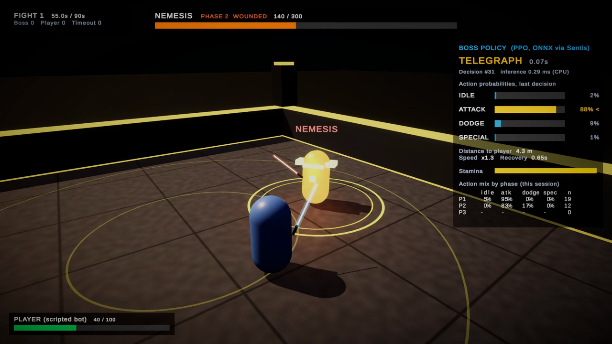

# Nemesis Boss AI

A boss fight in Unity where the boss's decisions come from a PPO policy (trained with ML-Agents, exported to ONNX, run in-game with Unity Sentis). The boss fights a scripted player bot in a walled arena. A separate Python bridge can add LLM-generated taunts.



## What it does

- **Policy-driven boss.** Every time the boss is idle it reads 14 observations and asks the ONNX policy for one of four actions: idle, attack, dodge or special attack. The chosen action then plays out through a fixed state machine: Idle, Telegraph (wind-up), Attack, Recovery (vulnerable), Dodge.
- **Phase escalation.** Below 66% and 33% HP the boss speeds up (x1.3, x1.6) and its recovery window shrinks (0.85 s, 0.65 s, 0.45 s).
- **Scripted opponent.** `PlayerController` keeps its distance, punishes the boss during Recovery, and dodges wind-ups.
- **AI overlay.** A HUD shows the boss's current state, the policy's probability for each action at the last decision (read from the model's softmax layer), the time each decision took, and the action mix per phase.
- **Presentation layer.** A third-person lock-on camera, energy blades with procedural sword animation tied to the boss's real state machine, telegraph rings that show attack range and wind-up progress, hit sparks, damage numbers, phase-coloured arena lighting and post-processing. All of it is visual only and does not change fight outcomes (verified below).
- **Graphics presets.** Low, Medium, High and Ultra, plus Auto, which picks one from the machine's VRAM, CPU threads and shader level.
- **Taunts (optional).** `llm_layer/state_bridge.py` receives game state over TCP and returns a short in-character line from Groq (`llama-3.3-70b-versatile`), filtered by a NeMo Guardrails config.

## Measured results

All numbers below were measured in the real Unity build (not a re-implementation), with the commands in [Reproducing the evaluation](#reproducing-the-evaluation). Episodes are 90 s at most. The opponent is the scripted player bot in every run.

| Boss | Episodes | Boss wins | Player wins | Timeouts | Boss win rate (95% CI) | Mean fight length |
|---|---|---|---|---|---|---|
| PPO policy (shipped `BossAgent.onnx`) | 600 | 510 | 0 | 90 | 85.0% (81.9% to 87.6%) | 74.3 s |
| Same boss body, always attack | 600 | 496 | 0 | 104 | 82.7% (79.4% to 85.5%) | 76.5 s |
| Same boss body, uniform random action | 600 | 598 | 0 | 2 | 99.7% (98.8% to 99.9%) | 55.3 s |
| Scripted FSM boss (scene default, 8 damage) | 600 | 600 | 0 | 0 | 100.0% (99.4% to 100.0%) | 19.6 s |
| Scripted FSM boss (10 damage, matched to RL boss) | 600 | 600 | 0 | 0 | 100.0% (99.4% to 100.0%) | 15.3 s |

Three seeds (1, 2, 3) x 200 episodes per row. Per-episode CSVs and summaries are in [`eval/unity/`](eval/unity/).

**Reading this honestly.** Against this player bot, the trained policy is not better than "always attack" in the same boss body, and a uniformly random policy wins more often and faster. The policy picks attack about 89% of the time (dodge about 6%, special about 2.5%, idle about 2.7%). The scripted FSM boss wins every fight, but it is a different body: it has no telegraph and no recovery window, so the bot never gets a punish opening. The likely cause is a train/deploy mismatch (see [Known issues](#known-issues)): the policy was trained in an earlier version of the game with one action per physics step, 100 HP, 15 s episodes and no state machine.

**Inference time per decision** (tensor setup, `Execute`, and reading the result back), Sentis 1.2 on the CPU backend, i9-10900K, measured over every decision in the RL runs above (about 8,200 decisions per seed, first 10 skipped as warm-up):

| | mean | p50 | p95 | p99 |
|---|---|---|---|---|
| Sentis CPU | 0.38 ms | 0.35 ms | 0.58 ms | 0.92 ms |

These runs had 8 evaluation processes running in parallel on a 10-core CPU, so single-instance latency is likely lower. In a short windowed run the GPUCompute backend averaged 1.9 ms per decision, but that sample was small (19 decisions) and the GPU was shared with another workload, so treat it as indicative only. The boss makes about one decision every 1.5 to 2 s, so either backend is negligible next to the frame budget.

**Determinism.** With a fixed `-seed`, repeated runs produce byte-identical episode CSVs, including runs at different time scales (25x and 100x) and the 1080p recording run with every visual effect enabled.

**Frame time** is not reported yet: the GPU was busy with another workload during this session. Measure it with:

```powershell
& ".\Unity Project\Builds\Windows\Nemesis.exe" -nemesisFrames 60 -quality high -screen-width 1920 -screen-height 1080 -screen-fullscreen 0 -out eval\frames_high
```

## Running it

Requirements: Unity 2022.3.62f3 (packages resolve from `Unity Project/Packages/manifest.json`: Sentis 1.2.0-exp.2, URP 14.0.12, TextMesh Pro 3.0.7). Python 3.10+ only for the taunt bridge and the result summariser.

**In the Editor.** Open `Unity Project/` in Unity Hub, open `Assets/Scenes/CombatScene.unity`, press Play. The camera, overlay, effects and settings menu are created at runtime, so the scene file is unchanged.

**As a build.**

```powershell
& "C:\Program Files\Unity\Hub\Editor\2022.3.62f3\Editor\Unity.exe" -batchmode -quit -nographics -projectPath "Unity Project" -executeMethod NemesisBuild.BuildWindows
```

```powershell
& ".\Unity Project\Builds\Windows\Nemesis.exe"
```

### Controls and settings

| Key | Action |
|---|---|
| Esc | Settings menu: graphics preset, camera mode, overlay, FPS counter |
| Tab | Show or hide the AI overlay |
| C | Switch camera: third-person lock-on or elevated broadcast view |

| Preset | Pipeline asset | Render scale | AA | Shadows | Post-processing | Effects |
|---|---|---|---|---|---|---|
| Low | URP-Performant | 0.75 | none | off | off | minimal, 60 fps cap |
| Medium | URP-Balanced | 1.0 | 2x MSAA | 35 m | tonemapping, vignette | reduced |
| High | URP-HighFidelity | 1.0 | 4x MSAA + SMAA | 50 m | full, with bloom | full |
| Ultra | URP-HighFidelity | 1.5 | 4x MSAA + SMAA | 80 m | full, with bloom | full + pillar lights |

Auto picks Low for handhelds, shader level below 4.5 or under 2 GB VRAM; Medium for integrated GPUs, under 4 GB VRAM or under 4 threads; High under 8 GB VRAM or under 8 threads; Ultra otherwise. The choice is saved between runs. Command-line overrides: `-quality low|medium|high|ultra|auto`, `-camera third|broadcast`, `-fixedCamera` (original scene camera), `-noFx`, `-noOverlay`.

### Taunt bridge (optional)

```powershell
copy .env.example .env   # then set GROQ_API_KEY
pip install -r requirements.txt
python llm_layer/state_bridge.py
```

Unity sends `{"boss_hp", "phase", "last_move", "player_hp"}` every 6 s over TCP port 9999 and shows the reply in the dialogue panel. Without the bridge the game logs one warning and runs normally. `python test_bridge.py` checks the bridge without Unity.

## Reproducing the evaluation

`EvalRunner` is built into the player and only activates with command-line flags. Everything game-related runs in `FixedUpdate` (50 Hz), so time scale changes speed, not results.

```powershell
.\eval\run_unity_eval.ps1                     # builds, then 200 episodes x seeds 1,2,3 for every row above
.\eval\run_unity_eval.ps1 -Episodes 50 -Seeds 1 -SkipBuild
```

Single runs:

| Flag | Meaning |
|---|---|
| `-nemesisEval N` | run N episodes headless, write `<out>_episodes.csv` and `<out>_summary.json`, quit |
| `-boss rl\|fsm` | RL boss or scripted FSM baseline |
| `-policy random\|attack` | ablation: keep the RL boss body, replace the policy's choice |
| `-fsmDamage X` | override the FSM baseline's damage |
| `-seed N` | seeds the player bot, the FSM boss and the policy's action sampling |
| `-sentis cpu\|gpu` | Sentis backend (CPU is used automatically with `-nographics`) |
| `-nemesisFrames S` | run S seconds in real time and record frame times |
| `-nemesisRecord S` | render offscreen at a fixed frame rate and pipe frames to ffmpeg (`-fps`, `-width`, `-height`, `-ffmpeg`) |

`python eval/summarize_unity_eval.py eval/unity` prints the results table.

The older `eval/run_eval.py` is a standalone Python re-implementation of the fight. Its constants differ from the Unity scene (boss damage 12 vs 10, player damage 4 vs 10, 60 s vs 90 s episodes, player HP 250 vs 100), and its committed `eval/results.csv` (RL boss 0/200 wins, all timeouts) does not match the Unity build. Use the Unity harness for any reported number.

## The gameplay clip

`media/nemesis_fight_seed21_1080p60.mp4` (78 s, 1920x1080, 60 fps, about 55 MB, gitignored) is one full fight, seed 21, Ultra preset, recorded offscreen with:

```powershell
& ".\Unity Project\Builds\Windows\Nemesis.exe" -batchmode -nemesisRecord 78 -fps 60 -seed 21 -sentis cpu -quality ultra -ffmpeg ffmpeg -out media\nemesis_fight_seed21_1080p60
```

The boss wins at 74.8 s with 80/300 HP left, after reaching its third phase. The same seed run headless gives the identical result.

## Combat values (from the scene)

| | Boss | Player bot | FSM baseline |
|---|---|---|---|
| HP | 300 | 100 | 300 |
| Damage | 10 (special 20) | 10 | 8 |
| Range | 2.5 | 2.8 | 2.4 |
| Attack cooldown | state machine | 1.2 s | 1.2 s |
| Move speed | 3.0 (x1.3, x1.6 by phase) | 2.0 | 3.0 |

Boss state timings: Idle 0.35 s, Telegraph 0.45 s, Attack 0.30 s, Recovery 0.85 / 0.65 / 0.45 s by phase, Dodge 0.50 s. The special attack needs 20 stamina unless the boss is in phase 3.

## Observation vector (14 floats)

| Index | Feature |
|---|---|
| 0, 1 | boss HP / max, player HP / max |
| 2 to 5 | boss x, z and player x, z, divided by 10 |
| 6 | distance / 20 |
| 7 | phase / 2 |
| 8 | last action / 3 |
| 9, 10 | player velocity x, z / 10 |
| 11 | stamina / 100 |
| 12 | episode time / 90 |
| 13 | constant 1/3 (curriculum player speed during training) |

## Training

The shipped model (`results/boss_v3/`, copied to `Unity Project/Assets/Models/BossAgent.onnx`) was trained with ML-Agents PPO for 300,000 steps using `config/boss_ppo.yaml` (batch 1024, buffer 10240, learning rate 3e-4 linear, gamma 0.99, lambda 0.95, epsilon 0.2, 2 x 256 hidden units, normalised inputs). The training-time agent is preserved, commented out, in git history (`a13f261`, `BossAgent.cs`).

| Run | Steps | Final mean reward |
|---|---|---|
| `boss_curriculum01` | 18,379 | 5.53 |
| `boss_final1` | 300,035 | 16.66 |
| `boss_v3` (shipped) | 300,030 | 14.93 |

`train_rllib.py` is a separate distributed PPO benchmark on a simplified gym environment (100 HP, 300-step episodes), not the shipped policy. Wall time for about 52,000 steps:

| Rollout workers | Wall time | Speedup |
|---|---|---|
| 1 | 77.2 s | 1.00x |
| 2 | 50.8 s | 1.52x |
| 4 | 35.5 s | 2.17x |
| 8 | 29.5 s | 2.62x |

## Known issues

1. **Train/deploy mismatch.** The policy was trained with one action per physics step, damage on every step in range, 100 HP on both sides, 15 s episodes and no state machine. In the shipped game it is queried once per state-machine cycle, with 300/100 HP and 90 s episodes, and observation 12 is time / 90 instead of time / 15. Retraining in the current game is the likely fix.
2. **Special attack in phase 3.** The action mask allows the special attack in phase 3 even with stamina below 20, but the attack then deals no damage.
3. **Uneven baseline.** The scene gives the FSM baseline 8 damage while the RL boss deals 10. The table includes a matched 10-damage run.
4. **Missing volume profile on fresh clones.** The scene's post-processing profile (`SampleSceneProfile.asset`) is gitignored. The runtime visual layer replaces it, so this only matters with `-noFx`.

## Project structure

```
nemesis-boss-ai/
  config/                 ML-Agents PPO and curriculum configs
  eval/
    run_unity_eval.ps1    headless evaluation in the Unity build
    summarize_unity_eval.py
    unity/                per-episode CSVs and summaries behind the results table
    run_eval.py           older Python re-implementation (see note above)
  llm_layer/              taunt bridge and guardrails config
  media/                  recorded clips (gitignored, except preview.png)
  results/                ML-Agents runs: ONNX, checkpoints, logs
  train_rllib.py          RLlib distributed PPO benchmark
  Unity Project/
    Assets/Scripts/
      BossAgent.cs        Sentis inference + boss state machine + phases
      PlayerController.cs scripted player bot
      ScriptedBoss.cs     FSM baseline boss
      EvalRunner.cs       headless evaluation, frame timing, offscreen recording
      BossDebugOverlay.cs AI overlay
      ArenaCamera.cs      third-person and broadcast cameras, camera shake
      VisualFX.cs         lighting, post-processing, arena, effects
      FighterAnimator.cs  energy blades and procedural sword animation
      QualityPresets.cs   Low / Medium / High / Ultra / Auto
      SettingsMenu.cs     in-game settings
      TauntDisplay.cs     taunt bridge client and dialogue panel
    Assets/Editor/NemesisBuild.cs   command-line build, FX material generation
    Assets/Resources/NemesisFX/     effect materials and the recording composite shader
```

## License

MIT, see `LICENSE`.
